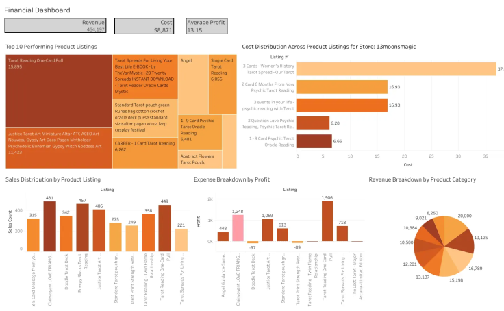
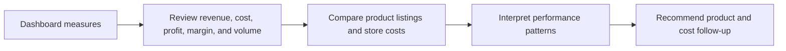

# Financial Performance & Profit Analysis Dashboard

**Positioning:** Product Analytics with a profitability lens

## Executive summary
The Tableau dashboard compares product listings across revenue, cost, profit, margin, and sales volume. The analysis highlights product and store patterns that can guide focused performance review.

## Business question and pipeline
Which product listings combine sales activity with stronger profitability, and which listings warrant a closer review?

## Business KPIs

| Metric | Dashboard value | Formula and interpretation |
|---|---:|---|
| Revenue | **454,197** | Total displayed revenue; compare by product listing. |
| Cost | **58,871** | Total displayed cost; compare across products and stores. |
| Average Profit | **13.15** | Average displayed profit per dashboard record. |
| Profit margin | Dashboard legend spans **2K–16K** | Standard formula: `Profit ÷ Revenue × 100`. Read as a percentage when displayed on a percentage scale. |
| Listing sales count | Dashboard legend spans **221–481** | Sales volume by listing; compare with profitability measures. |

## Model Metrics
This is a descriptive dashboard with no predictive model. Accuracy, AUC, and prediction error do not apply.

## Insights and interpretation
- Product listings are compared by sales and profitability measures, alongside store-level cost distribution.
- Sales volume and profit should be considered together when reviewing product performance.

## Recommendations
1. Compare products using sales volume, profit, and margin together.
2. Review store-level cost patterns for operational follow-up.
3. Use margin and cost context before prioritizing products based on volume alone.

## Project files
- [Dashboard image](data_visualization_and_analysis/dashboard-overview.png)
- [Analysis data](data/cleaned_data.xlsx)

## Supporting documents
- [Executive summary](docs/Executive-Summary.md)
- [Business requirements summary](docs/BRD-Summary.md)
- [Functional requirements summary](docs/FRD-Summary.md)