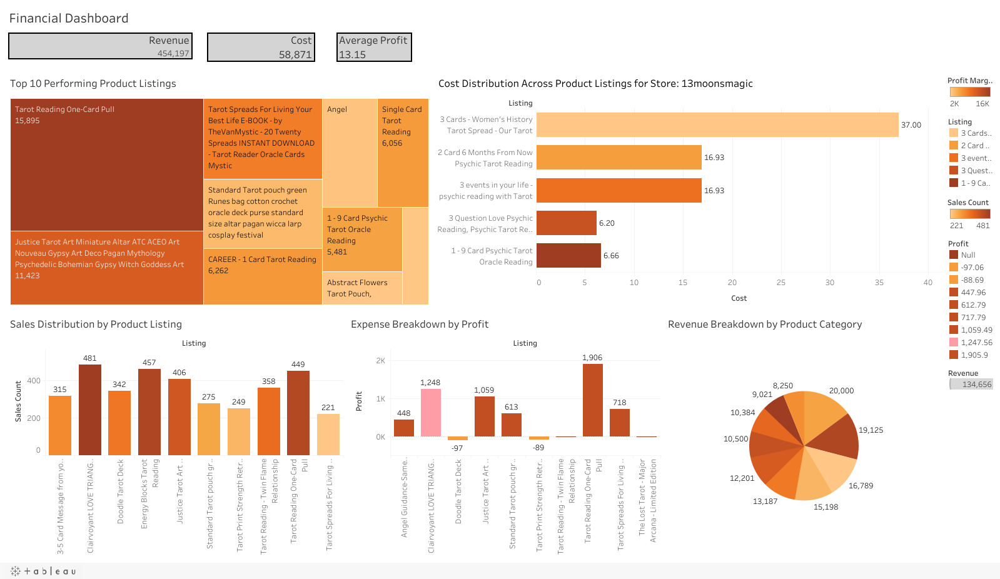
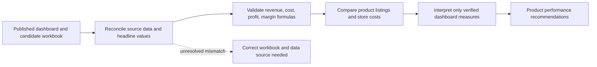

# Financial Performance & Profit Analysis Dashboard

**Recommended positioning:** Product Analytics with a profitability lens | **Status:** published measures found; local source mismatch needs resolution

## Executive summary
The public dashboard reports Revenue **454,197**, Cost **58,871**, and Average Profit **13.15**, and compares product listings by profit, margin, sales count, and cost. The numbers can be described as dashboard-reported values, but the correct formulas and local workbook have not been verified.

## Business question and pipeline
Which product listings combine sales activity with stronger profitability, and which listings warrant a closer review?

## Business KPIs

| Metric | Dashboard value | Formula and interpretation status |
|---|---:|---|
| Revenue | **454,197** | Dashboard label suggests total revenue, but a valid calculation is not verified. The local candidate workbook calculates a field named `Revenue` as `[cost] - [sales_count]`, which subtracts unlike measures and should not be presented as a meaningful revenue formula. |
| Cost | **58,871** | `SUM([Cost])` would be the total if the field is a row-level cost amount; exact source field, aggregation, and currency are not verified against the public dashboard. |
| Average Profit | **13.15** | Candidate definition: `AVG([Profit])`. The profit calculation, unit, and denominator (listing, order, or row) are not documented in the local candidate workbook. |
| Profit margin | Dashboard legend displays values around **2K–16K** | A margin is normally `Profit ÷ Revenue × 100`. The displayed range is not expressed as a percentage, so the workbook’s field cannot be safely interpreted as a margin until its formula/format is corrected. |
| Listing sales count | Public dashboard legend spans **221–481**; local candidate maximum is **457** | `SUM([Sales Count])` by listing is the expected volume measure. This range is broadly compatible with the local data, but does not validate the rest of the workbook or headline formulas. |

## Model Metrics

No predictive or statistical model is reported; this is a descriptive dashboard. Accuracy, AUC, and prediction error are **not applicable** to the current analysis.

## Insights and interpretation
- The published dashboard is organized around product listings and sales/profitability comparisons, so Product Analytics is a closer portfolio theme than FP&A.
- The dashboard highlights top-performing listings and a store-level cost distribution, but the Revenue/Profit/Profit Margin formulas need validation before the rankings can support financial decisions.
- The local candidate `BI Final Project Tableau work.twbx` contains 4,183 rows and calculates `Revenue` as `[cost] - [sales_count]`. On its embedded data, that formula sums to about **131,688**, not the public dashboard’s **454,197**. The dashboard’s Profit Margin legend also shows values around 2K–16K rather than percentage values. These mismatches mean the local file is not included as the verified source.

## Recommendations
1. Confirm the correct published workbook and data file, then reconcile each displayed KPI to a transparent Tableau formula.
2. Define revenue from the actual selling-price and quantity fields; define profit as `Revenue − Cost`; define margin as `Profit ÷ Revenue × 100` only when those inputs are valid.
3. After reconciliation, compare listings on sales volume and profit margin together; avoid selecting products on volume or an unverified margin alone.

## Evidence and proposed structure
- No verified `.twbx` or matching source data is included. The local candidate `.twbx` is excluded because its formulas and totals do not reconcile to the published dashboard.

**Needed to finalize:** the Tableau workbook and source dataset that produced the public dashboard. The local `BI Final Project Tableau work.twbx` is excluded until its mismatch is resolved. The available report material does not support a formal BRD/FRD, As-Is process, or stakeholder plan.

## Supporting documents

- [Executive summary](docs/Executive-Summary.md)
- [Business requirements summary](docs/BRD-Summary.md)
- [Functional requirements summary](docs/FRD-Summary.md)

The source reports do not document an existing-state (As-Is) process; none is presented as fact.

